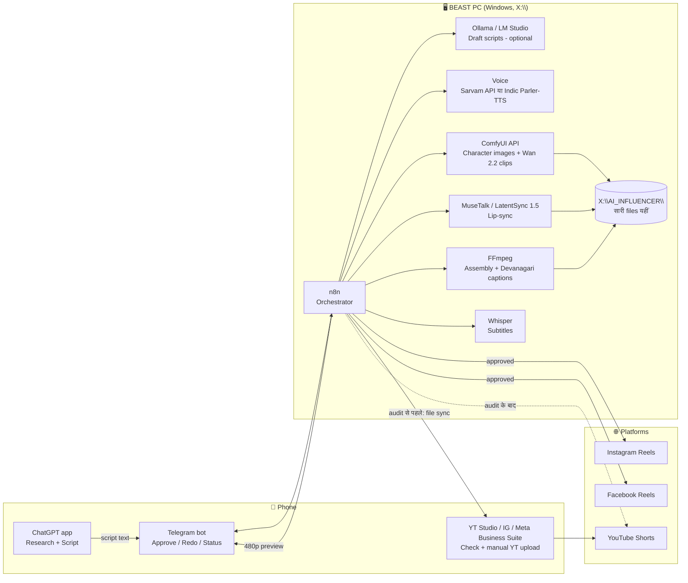

# 10 — Automated Pipeline: Phone से Control, BEAST PC पर Rendering

- **Date:** 2026-10-21
- **Stage:** Architecture और research (कुछ install या setup नहीं किया गया)
- **Labels:** VERIFIED · REPORTED · INFERENCE · UNKNOWN · CONFLICT

---

## 0. आपकी requirement

| Requirement | Design में कैसे पूरी होगी |
|---|---|
| Pipeline पूरी तरह automated हो | Idea से publish तक हर step script या workflow से चलेगा |
| Research और checking phone से | Telegram bot (approve/redo buttons) + ChatGPT app + platform apps |
| Rendering, setup और files सिर्फ़ BEAST PC पर | PC पर ही n8n, ComfyUI, FFmpeg, TTS और lip-sync चलेंगे; phone पर सिर्फ़ छोटे previews आएँगे |
| आपका समय: रोज़ 2–3 घंटे + weekend 5–6 घंटे (~105–130 घंटे/महीना) | Weekday पर 20–30 min phone approvals; बाकी काम weekend batch में |

---

## 1. सबसे पहले: 5 blockers जो research में मिले

| # | Blocker | असर | Workaround | Status / Source |
|---|---|---|---|---|
| 1 | **YouTube API:** 28 July 2020 के बाद बने, बिना verification वाले API project से `videos.insert` से upload हुई videos **private पर lock** होती हैं, जब तक project का compliance audit न हो जाए। | Day-1 पर YouTube auto-publish **काम नहीं करेगा** | (a) Audit apply करें (कुछ हफ़्ते, REPORTED); (b) तब तक final file phone पर sync हो और YouTube app से 1-tap upload करें; (c) कोई ऐसा scheduler tool जो पहले से verified हो (paid) | VERIFIED: developers.google.com/youtube/v3/docs/videos |
| 2 | **DaVinci Resolve free v21.1 में external Python scripting हट गई** | Resolve से automatic edit नहीं होगा | Automatic assembly **FFmpeg** से (free); Resolve/Nuke/AE सिर्फ़ weekend पर manual polish के लिए | REPORTED: pugetsystems.com (2026-09-10) |
| 3 | **ChatGPT Plus में API शामिल नहीं है** | n8n आपके ChatGPT subscription से अपने-आप script नहीं लिखवा सकता | (a) Scripts phone पर ChatGPT app में लिखें और Telegram bot को भेजें; (b) PC पर local LLM (Ollama/LM Studio, free) से draft बनवाएँ; (c) OpenAI API अलग से pay करें (छोटा खर्च, लेकिन अलग billing) | VERIFIED: help.openai.com (Plus overview: "API usage not included") |
| 4 | **Instagram API:** अपने account पर development mode से publish हो सकता है (account को "Instagram Tester" बनाना होता है)। Token 60 दिन चलता है और refresh करना पड़ता है। | Possible, लेकिन token refresh automate करना होगा | n8n में हर 50 दिन पर token-refresh workflow | REPORTED (vendor blogs; Meta docs से exact permissions verify करें) |
| 5 | **Remote access:** Tailscale Personal free plan के पुराने page पर "non-commercial use" लिखा है | Monetized channel के लिए license grey है | **Main control Telegram bot से रखें:** bot PC से बाहर की तरफ़ connect करता है, इसलिए कोई port नहीं खोलना पड़ता और VPN की ज़रूरत नहीं। Emergency के लिए remote desktop app। | CONFLICT: tailscale.com/pricing (current page पर 6 users free) बनाम पुराना plans page |

**Facebook Reels API:** 24 घंटे में 30 posts तक, video 3–90 सेकंड, 9:16, 1080×1920 recommended। ज़रूरी permissions: `pages_manage_posts`, `pages_read_engagement`, `pages_show_list` (VERIFIED: Meta Reels Publishing guide)। अपने Page के लिए development mode में बिना App Review काम करेगा या नहीं, यह **UNKNOWN** है, verify करना होगा।

**Instagram publish limit:** 24 घंटे में 100 posts (official content-publishing page), पुराने reference में 50 (CONFLICT)। आपके 1 Reel/day के लिए दोनों काफ़ी हैं।

**YouTube API quota:** `videos.insert` की cost 1,600 units (official calculator) बनाम ~100 units (Dec 2025 revision, REPORTED)। Default 10,000 units/day है। दोनों हालत में 1–2 uploads/day आराम से होंगे।

**AI disclosure via API:**
- **YouTube:** `status.containsSyntheticMedia = true` set करें (VERIFIED: Google revision history, 30 Oct 2024)।
- **Instagram/Facebook:** API से AI label set होता है या नहीं, यह **UNKNOWN** है। Profile पर "AI-generated profile" label एक बार manually लगाएँ।

---

## 2. Architecture



**Telegram क्यों:** Bot PC से Telegram servers की तरफ़ connect करता है (polling), इसलिए router पर port खोलने या PC को internet पर expose करने की ज़रूरत नहीं पड़ती (INFERENCE, standard bot design)। ComfyUI का API by default बिना password के होता है, इसलिए **उसे कभी सीधे internet पर न खोलें** (REPORTED: ComfyUI API references)।

---

## 3. Step-by-step flow (एक Reel की ज़िंदगी)

| Step | कहाँ | Automated? | आपका काम (phone) | समय |
|---|---|---|---|---|
| 1. Idea + research | Phone: ChatGPT app | आधा | Topic चुनना, ChatGPT से script लिखवाना | 5–10 min |
| 2. Script भेजना | Telegram bot → n8n | हाँ | Script paste करके `/new` भेजना | 1 min |
| 3. Voice | PC: Sarvam API (या local TTS) | हाँ | — | auto |
| 4. Images (character + scenes) | PC: ComfyUI API + character LoRA | हाँ | — | auto (रात में) |
| 5. Motion clips | PC: Wan 2.2 5B queue | हाँ | — | auto (रात में) |
| 6. Lip-sync (10–15s talking head) | PC: MuseTalk / LatentSync 1.5 | हाँ | — | auto (रात में) |
| 7. Assembly + captions | PC: FFmpeg + Whisper (Devanagari captions) | हाँ | — | auto |
| 8. Preview | Telegram पर 480p preview + caption/hashtags | हाँ | देखना → ✅ Approve / 🔁 Redo (कारण के साथ) | 2–3 min |
| 9. Publish IG + FB | n8n → Graph API, तय समय पर | हाँ | — | auto |
| 10. Publish YouTube | Audit से पहले: file phone पर sync → YouTube app से upload, "altered content" on। Audit के बाद: auto। | अभी नहीं / बाद में हाँ | 1 min upload | 1–2 min |
| 11. Report | n8n → रोज़ सुबह Telegram पर views/retention summary | हाँ | पढ़ना | 2 min |

**Human approval (step 8) हटाने की सलाह नहीं है।** कारण:
- Mass-produced content पर YouTube और Meta की policy सख़्त है (REPORTED)।
- Realistic चेहरे पर गलत lip-sync या गलत fact सीधे trust गिरा देगा।
- Approval में रोज़ सिर्फ़ 2–3 मिनट लगते हैं।

---

## 4. Weekly time plan (आपके घंटों के हिसाब से)

| दिन | काम | समय |
|---|---|---|
| **Mon–Fri (रोज़)** | सुबह report पढ़ना (2 min) · 1 script ChatGPT से + bot को भेजना (10 min) · कल की preview approve (3 min) · YouTube manual upload (2 min) · comments reply (15 min) | **~30–40 min** (बाकी 1.5–2 घंटे बचते हैं) |
| बचा हुआ weekday समय | अगले हफ़्ते के hooks/ideas, analytics देखना, benchmark tests | 1–2 घंटे |
| **Saturday** | 7 scripts batch में · character LoRA/face fixes · Nuke/AE में 1–2 hero shots polish · workflow sudhaar | 5–6 घंटे |
| **Sunday** (optional) | Long video (अगर करना हो) · पूरे हफ़्ते का analytics review · अगले हफ़्ते का schedule | 3–6 घंटे |

महीने का अनुमान ~60–80 घंटे है, जो आपके 105–130 घंटों में fit होता है (INFERENCE, not tested)।

---

## 5. Files और folders (सब PC पर)

`X:\` आपका authorized workspace है, इसलिए सुझाया गया structure:

```
X:\AI_INFLUENCER\
├── 00_inbox\            # Telegram से आई scripts (.txt / .json)
├── 01_assets\
│   ├── character\       # synthetic face references + LoRA
│   ├── voices\          # voice settings
│   └── music\           # licensed / platform-safe music
├── 02_jobs\<date_id>\   # हर Reel का पूरा काम: audio, images, clips, lipsync
├── 03_renders\          # final 1080x1920 masters
├── 04_previews\         # 480p previews (Telegram के लिए)
├── 05_published\        # posted files + metadata (URL, date, platform IDs)
├── 06_logs\             # n8n / ComfyUI logs, errors
└── 07_secrets\          # API tokens (Git में कभी नहीं; Windows permissions से lock)
```

Phone पर सिर्फ़ `04_previews` और YouTube upload वाली final file आएगी। बाकी सब PC पर रहेगा।

---

## 6. Tools: license और cost (pipeline layer)

| Tool | Role | License / cost | Status |
|---|---|---|---|
| n8n (self-hosted) | Orchestrator | Sustainable Use License: अपने internal/personal काम के लिए free; n8n को service बनाकर बेचना मना है | VERIFIED: docs.n8n.io |
| Telegram Bot API | Phone control | Free (INFERENCE) | Verify |
| ComfyUI API | Images/video | `/prompt`, `/history`, `/view`, `/queue`; default में auth नहीं | REPORTED |
| FFmpeg | Assembly | Free | INFERENCE |
| Whisper | Subtitles | MIT | VERIFIED |
| YouTube Data API | Upload | Free quota; audit ज़रूरी | VERIFIED |
| Instagram Graph API | Reels publish | Free; अपने account के लिए dev mode | REPORTED |
| Facebook Reels API | Page Reels | Free; 30/24h | VERIFIED |
| Sarvam Bulbul v3 | Voice | ₹30 / 10K chars | VERIFIED |
| OpenAI API (optional) | Auto scripts | Plus से अलग billing | VERIFIED (separate) |

**Pipeline layer पर extra खर्च: ₹0** (optional OpenAI API छोड़कर)। Total खर्च report के section 10 जैसा ही रहेगा: ~₹1,500–1,620 महीना।

---

## 7. Risks

| Risk | Level | Mitigation |
|---|---|---|
| YouTube audit में देरी या reject | High | शुरुआत से manual YouTube upload को ही plan मानें |
| API token expire होने से posts रुकें | Medium | Token refresh workflow + Telegram पर expiry alert |
| PC बंद, crash या बिजली जाए | Medium | UPS; Windows auto-restart पर n8n/ComfyUI auto-start; failed job का Telegram alert |
| Security (PC हमेशा on है) | Medium | कोई port नहीं खुलेगा; tokens `07_secrets` में; Windows updates; strong passwords |
| बिना review के गलत content post हो जाए | High | Step 8 approval अनिवार्य |
| Instagram/Facebook API policy बदल जाए | Medium | Meta Business Suite manual scheduling backup |

---

## 8. Verify करने वाली चीज़ें (setup से पहले)

1. YouTube API audit form और इसका समय (official)
2. Instagram Login API की exact permissions और 60-day token rule (Meta docs)
3. Facebook Page Reels publish development mode में बिना App Review होता है या नहीं
4. Instagram/Facebook API से AI label set हो सकता है या नहीं
5. Tailscale/remote-desktop के license terms (अगर emergency access चाहिए)

---

## Sources (2026-10-21)
- YouTube private-lock rule: https://developers.google.com/youtube/v3/docs/videos
- YouTube quota: https://developers.google.com/youtube/v3/determine_quota_cost
- containsSyntheticMedia: https://developers.google.com/youtube/v3/revision_history
- Instagram publishing limit: https://developers.facebook.com/docs/instagram-platform/content-publishing
- Instagram dev-mode publishing (REPORTED): https://changelog.zernio.com/blog/instagram-graph-api · https://www.blotato.com/blog/instagram-posting-api
- Facebook Reels Publishing: https://developers.facebook.com/docs/video-api/guides/reels-publishing
- n8n license: https://docs.n8n.io/n8n-community-license/sustainable-use-license
- Tailscale pricing: https://tailscale.com/pricing/
- ComfyUI API (REPORTED): https://www.mintlify.com/Comfy-Org/ComfyUI/api/overview · https://9elements.com/blog/hosting-a-comfyui-workflow-via-api/
- Resolve free scripting removal: https://www.pugetsystems.com/blog/2026/09/10/how-davinci-resolve-free-v21-1-scripting-changes-affect-puget-bench/
- ChatGPT Plus ≠ API: https://help.openai.com/en/articles/6950777-what-is-chatgpt-faq
